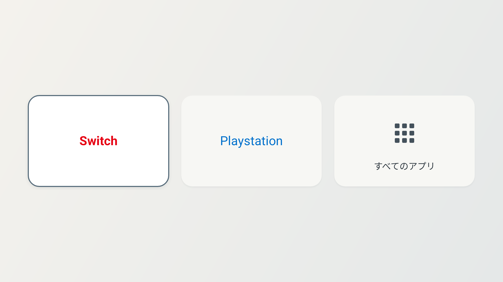

# Quiet TV

Xiaomi TV S Mini LED 55 2025 向けの、HDMI入力とアプリ一覧だけを置くAndroid TV / Google TVランチャー。



## 表示と操作

- Google TVのHDMI入力設定で付けた名前を、そのままカード名に使います。
- Google TVの設定で非表示にした入力を除き、すべてのHDMI入力と「すべてのアプリ」を表示します。入力名による表示対象の制限はありません。
- 名前に `Switch` が含まれると文字色は `#E60012`、`PlayStation` が含まれると `#0070CC`（RGB 0, 112, 204）になり、その他の入力は通常の文字色で表示します。背景は通常時 `#F7F7F4`、フォーカス時 `#FFFFFF`。選択中は濃い枠線 `#566B7A` と太字・影で示します。
- 文字色の判定では大文字・小文字を区別しません。`Nintendo Switch 2`、`PlayStation 5` も一致し、`PS5` だけでは一致しません。両方を含む場合はSwitchを優先します。
- カードは1行に最大4枚で、入力が多い場合は複数行に表示します。
- 切断中もカードを残し、CEC子入力と物理HDMIの重複を防ぎます。Google TVで非表示の入力は表示しません。
- 「すべてのアプリ」は起動可能なTVアプリと通常アプリをパッケージ単位でまとめて表示します。起動画面のないシステムサービスは対象外です。上部に「Google TVの設定」ボタンがあり、十字キーの上で移動できます。設定アプリも一覧に含めます。
- 十字キーで移動、決定で開き、戻るで一覧からホームへ戻ります。ホーム上の戻るでは終了しません。
- 入力名は画面に戻るたびに読み直します。HDMI入力の追加・削除・更新も監視します。

インターネット権限、外部API、広告SDK、WebView、常駐ポーリングはありません。純正アプリを有効に保つため、Google TVのホーム表示だけを検知するユーザー補助サービスを利用できます。画面内容は取得しません。任意のHome直接起動機能のみキーイベント受信の権限を使い、Home以外は通過させます。入力の記録・保存・送信は行いません。OSや既存Google TVアプリのファイル自体は変更しません。添付ポストにあるRAM削減率や高速化倍率は本アプリでは未測定です。

## ビルド

Android SDK 36、Build Tools 35.0.0、JDK 17以降（Gradle 8.13が対応するバージョン）を用意し、`local.properties` に `sdk.dir=/path/to/Android/sdk` を記入します。対象SDKも36です。

```sh
./gradlew assembleDebug lintDebug assembleDebugAndroidTest
sh scripts/test-rules.sh
python3 scripts/test-restore.py
```

APK: `app/build/outputs/apk/debug/app-debug.apk`。個人用のデバッグ署名APKです。同じ署名鍵を使って更新してください。Gradleは初回のみビルド用依存を取得します。アプリ本体に追加ライブラリはありません。

## テレビにインストール

1. テレビとMacを同じネットワークに接続します。
2. テレビの「設定 → システム → デバイス情報」からOSビルドを繰り返し選んで開発者向けオプションを有効にします。メニュー名はファームウェアにより異なります。
3. 開発者向けオプションでデバッグを有効にします。ワイヤレスデバッグがある場合は「ペア設定コードでデバイスをペア設定」を開きます。
4. 次を実行します。ペア設定ポートと接続ポートは異なります。テレビ側でこのPCからの接続を許可してください。

```sh
adb pair TV_IP:PAIRING_PORT
# 画面のコードを対話入力
adb connect TV_IP:CONNECT_PORT
adb devices -l
adb -s TV_IP:CONNECT_PORT install -r app/build/outputs/apk/debug/app-debug.apk
adb -s TV_IP:CONNECT_PORT shell am start -n com.beryu.tvhome/.MainActivity
```

古いADBでペア設定に失敗する場合はAndroid SDK Platform-Toolsを更新するか、テレビが提供する従来のネットワークデバッグ接続と、テレビ画面上の認証を使います。`unauthorized` の間はインストールできません。

5. 必要に応じてGoogle TVの入力設定でHDMI入力名と表示・非表示を設定します。アプリにはGoogle TV側の実際の名前が表示されます。
6. 各カードから正しいHDMI映像へ切り替わることと、アプリ一覧の起動を確認します。

## ホームに設定・元に戻す

Xiaomiの純正ホームとGoogle TV初期設定アプリは有効のまま使います。純正ホーム内に右側設定パネルやリモコン用受信機能があるため、これらのパッケージを無効化しないでください。

1. テレビの「設定 → システム → ユーザー補助」を開きます（メニュー名はファームウェアによって異なります）。
2. 「Quiet TV ホーム切替」を有効にします。
3. リモコンのHomeボタンでQuiet TVへ移動し、設定ボタンで純正の右側パネルが開くことを確認します。

このサービスは `com.google.android.apps.tv.launcherx` の画面切り替えイベントだけを受け取り、純正HomeActivityが表示された場合にQuiet TVを開きます。DashboardHandlerや設定画面、他のアプリは対象外です。画面内容の取得権限、キー入力フィルタ、音声出力機能はありません。既存のButton Mapperと併用できます。

### Homeボタンからの直接起動（1.0.5以降・任意）

「Quiet TV Homeボタン直接起動」は、Homeキーを純正ホームが描画される前に処理する別のユーザー補助サービスです。画面表示を検知してから開く「ホーム切替」と異なり、キーイベント受信権限への追加同意が必要です。Androidからキーイベントが通知されますが、Home以外は即座に通し、入力の記録・保存・送信や画面内容の取得はしません。

Homeの最初の押下でQuiet TVを開き、その押下に対応する解放まで処理します。長押し・連打もQuiet TV起動として扱うため、Homeキーの既存の長押し・ダブルタップ機能は利用できなくなります。音量・設定・戻るなど他のキーは変更しません。「ホーム切替」は電源復帰などのために併用できます。

本機では、明示的な同意後に直接起動サービスを有効にし、物理Homeキーで純正画面を挟まず開くことをユーザーと画面遷移ログで確認しました。Button Mapper併用と右側設定パネルの維持も確認済みです。詳細は `docs/DIRECT-HOME.md` を参照してください。

純正ホームへ戻すには、ユーザー補助設定でQuiet TVの両サービスを無効にします。1.0.3以前の手順で純正パッケージを停止した場合や、ADBから戻す場合は次を実行します。

```sh
ADB=/path/to/adb sh scripts/restore-google-tv.sh TV_IP:PORT
```

スクリプトはQuiet TVの2つの補助サービスだけを有効サービス一覧から取り除き、他のユーザー補助サービスを保持して、純正2パッケージと既定ホームを復元します。Quiet TVを削除する場合は先に復元してください。詳しくは [システム機能との共存](docs/SYSTEM-INTEGRATION.md) を参照してください。

## 互換性と実機確認

Android 8.0 / API 26以降。`TvInputManager` / `TvInputInfo.loadCustomLabel()` で入力を読み、`TvContract.buildChannelUriForPassthroughInput()` の `ACTION_VIEW` をテレビのTVアプリへ渡します。

メーカーが入力情報や起動先を標準APIに公開していない場合は、実機での調査・調整が必要です。権限エラーはクラッシュさせず画面に案内します。標準APIの存在だけでは、Xiaomiの全ファームウェアでの切り替え成功は保証できません。

参考: [入力名API](https://developer.android.com/reference/android/media/tv/TvInputInfo#loadCustomLabel(android.content.Context)) / [HDMI用URI](https://developer.android.com/reference/android/media/tv/TvContract#buildChannelUriForPassthroughInput(java.lang.String)) / [TVアプリ設定](https://developer.android.com/training/tv/get-started/create)

Nintendo Switch、PlayStationの名称・商標は各権利者に帰属します。

## 画面操作のスモークテスト

テスト用APKを併せてインストールした端末で明示的に実行します。テストの途中だけ仮のHDMIカードを描画し、通常起動には影響しません。入力切り替えの成功はこのテストの対象外で、実機のHDMI機器で確認します。

```sh
adb install -r app/build/outputs/apk/androidTest/debug/app-debug-androidTest.apk
adb shell am instrument -w com.beryu.tvhome.test/com.beryu.tvhome.SmokeInstrumentation
```

初期フォーカス、十字キー移動、アプリ一覧、一覧内移動、設定ボタンへの移動と設定Intent、戻るを確認し、ホームとアプリ一覧のスクリーンショットをアプリの内部ファイル領域に保存します。デバッグAPKでは `adb exec-out run-as com.beryu.tvhome cat files/apps-preview.png > apps.png` で取り出せます。

先行研究: [simbasjungles/free-my-tv](https://github.com/simbasjungles/free-my-tv)。`HomeApps.java` の物理HDMIとCEC子入力の整理、設定名の優先、HDMI URI、`ANDROID_SETTINGS` の `Settings.ACTION_SETTINGS` 導線を確認して参考にしています。本プロジェクトはコードや素材をコピーせず独立して実装しています。
